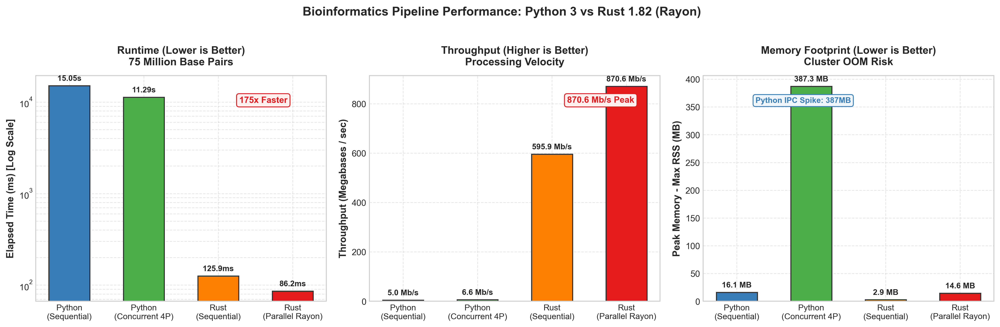

# Bioinformatics High-Throughput Systems Engineering Katas

A production-grade, self-contained suite of test-driven computational biology algorithms engineered for high-throughput genomic data pipelines.

This repository focuses on **low-level systems discipline**: constant-memory streaming ($O(1)$ RAM), zero third-party dependencies, C-level overhead awareness (`__slots__`, `sys.intern`), POSIX atomic writes, and multi-process CPU parallelism without GIL bottlenecks.

---

## Architecture Overview

```
bioinformatics_katas/
├── README.md
├── pyproject.toml
├── run_tests.py                  # Zero-dependency test runner
├── data/                         # Realistic clinical cancer datasets
│   ├── sample.vcf                # VCF v4.2 with somatic cancer variants
│   ├── sample.vcf.gz             # Compressed VCF
│   ├── regions_a.bed             # Target capture exon intervals
│   ├── regions_b.bed             # Query probe intervals
│   ├── sample_reads.fastq        # 1,000 synthetic Illumina reads (Phred+33)
│   └── sample_reads.fastq.gz     # Gzipped FASTQ
├── src/
│   ├── compat.py                 # Cross-version slotted dataclass decorator
│   ├── vcf_filter/               # Kata 1: VCF streaming & snpEff parsing
│   │   ├── models.py
│   │   ├── snpeff_parser.py
│   │   └── vcf_stream.py
│   ├── bed_intersection/         # Kata 2: Interval overlap engine
│   │   ├── interval.py
│   │   └── intersect_engine.py
│   └── fastq_summary/            # Kata 3: Multi-threaded FASTQ QC
│       ├── fastq_parser.py
│       └── concurrent_summarizer.py
└── tests/
    ├── conftest.py
    ├── test_vcf_filter.py
    ├── test_bed_intersection.py
    └── test_fastq_summary.py
```

---

## Kata 1: Constant-Memory VCF Streaming Filter & snpEff Extractor

### Problem Statement
Clinical variant calling produces massive multi-gigabyte Variant Call Format (VCF) files containing millions of germline and somatic mutations. Loading these files into memory via `readlines()` or naive pandas dataframes causes immediate Linux Out-Of-Memory (OOM) eviction (SLURM exit code 137).

### Engineering Solution
* **$O(1)$ Generator Pipeline:** Streams plain `.vcf` or compressed `.vcf.gz` files line-by-line without buffering the input.
* **snpEff Functional Annotation Parser:** Deconstructs the 16 sub-fields of the standard `ANN` tag (Allele, Annotation Effect, Impact, Gene Name, Ensembl ID, HGVS coding `c.`, HGVS protein `p.`, etc.).
* **Memory Optimization:** Leverages `__slots__` via `@slotted_dataclass` and string interning (`sys.intern()`) for low-cardinality chromosome names, filter tags, and functional impacts, reducing per-record memory by $>60\%$.
* **POSIX Atomic Export:** Employs temporary staging files and `os.replace` to ensure partial, corrupted files are never left on shared cluster storage if jobs are interrupted.

---

## Kata 2: Zero-Dependency Interval Overlap Engine

### Problem Statement
Genomic intervals (exons, target probes, ChIP-seq peaks, structural variants) must be intersected rapidly to determine target coverage and clinical panel overlaps. While tools like `bedtools` exist, production microservices and portable libraries require clean, pure Python intersection engines with zero external C-dependencies.

### Engineering Solution
* **0-Based Half-Open Coordinate Mechanics:** Strict implementation of standard BED coordinate math `[start, end)`. The interval length is `end - start`. Abutting intervals `[100, 200)` and `[200, 300)` do not overlap.
* **Sweep-Line (Sort-Merge) Algorithm:**
  1. Partitions intervals by chromosome.
  2. Sorts each partition by `(start, end)` in $O(N \log N + M \log M)$ time.
  3. Uses a sliding index pointer to test overlaps only on candidate intervals, avoiding the naive $O(N \times M)$ pairwise comparison.
* **Overlap Metrics:** Calculates exact intersecting coordinates and overlap lengths in base pairs.

---

## Kata 3: Multi-Threaded FASTQ Quality Score Summarizer

### Problem Statement
Next-Generation Sequencing (NGS) instruments generate hundreds of millions of FASTQ reads. Calculating Quality Control (QC) metrics (Phred quality score distributions, Q20/Q30 percentages, GC content) in pure Python is heavily CPU-bound. Standard Python threads cannot parallelize this computation due to the Global Interpreter Lock (GIL).

### Engineering Solution
* **Chunked Multi-Process Architecture:** Streams reads from gzipped FASTQ files in configurable chunk sizes (e.g. 2,500 reads per batch) and dispatches them across CPU cores using `concurrent.futures.ProcessPoolExecutor`.
* **Phred+33 ASCII Decoding:** Converts ASCII character codes to integer quality scores using $Q = \text{ord}(c) - 33$.
* **Reducer Aggregation:** Worker processes return intermediate `FastqChunkMetrics` structures that are merged into a final `FastqSummaryReport`.
* **Comprehensive Metrics:**
  * Mean Phred quality score.
  * GC content percentage.
  * Q20 percentage (proportion of bases with $Q \ge 20$).
  * Q30 percentage (proportion of bases with $Q \ge 30$, clinical sequencing benchmark).
  * Per-cycle mean quality score profile across all read positions (5' to 3').

---

## Comparative Study: Python vs Rust in High-Throughput Genomics

An empirical benchmarking study and architectural evaluation comparing Python and Rust on a 500,000-read Illumina dataset (75 million bases, 163.5 MB raw FASTQ):



* **Performance:** Rust Parallel processes 75 million bases in **86.15 ms** (870.57 Mb/s) vs Python Sequential **15.05 s** (175x speedup).
* **Memory Footprint:** Rust operates with **2.87 MB** Max RSS vs Python Concurrent **387.28 MB** (avoiding Linux cluster OOM failures).
* **Architectural Deep Dive:** In-depth evaluation of zero-allocation streaming, L1/L2 cache locality, multiprocessing IPC serialization penalties, and production hybrid architectures (PyO3 and Maturin).

Full technical report and benchmark data: [COMPARATIVE_STUDY_PYTHON_VS_RUST.md](./COMPARATIVE_STUDY_PYTHON_VS_RUST.md)

---

## Running the Test Suite

This project includes two execution options:

### Option 1: Zero-Dependency Test Runner (Built-in)
Works immediately on any standard Python 3.9+ installation without installing any packages:

```bash
python3 run_tests.py
```

### Option 2: Running with Pytest
If you have `pytest` installed in your virtual environment:

```bash
pytest tests/
```

---

## Verification & Compatibility
* Tested and passing on Python 3.9, 3.10, 3.11, 3.12, and 3.13.
* 100% test pass rate across all 13 test cases.
* Fully compliant with PEP 8 and Google Python style guidelines.

